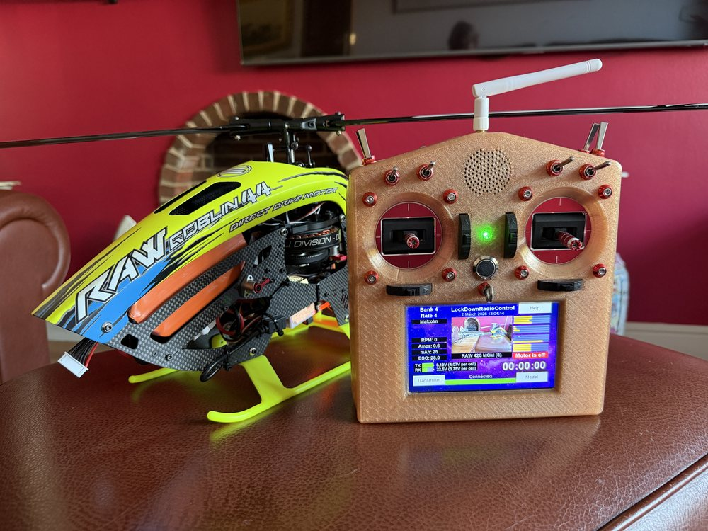
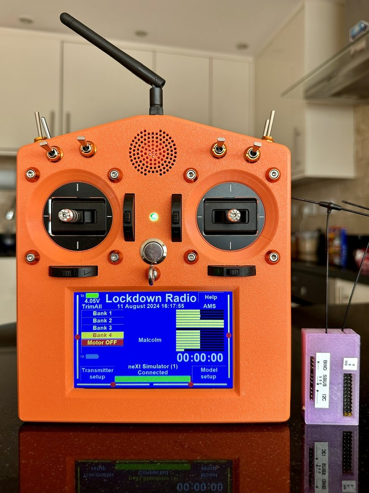

# LockDownRadioControl, Version 1

> [!NOTE]
> **Version 2 is here (October 2026).** The same transmitter with a 5-inch WiFi touchscreen that updates the whole radio from the internet, a new receiver that sets up Rotorflight from your phone, and a free phone app.
> - Code, boards and case: the [LDRC_V2 repository](https://github.com/Mmessiter/LDRC_V2).
> - What it does, and how to build one: [messiter.com/LDRC.html](https://messiter.com/LDRC.html) and [Build one](https://messiter.com/ldrc/build.html).
> - **Starting a new build? Build Version 2.** It uses this same main board, sticks and switches, with a cheaper screen and a new case front, and it updates itself.
>
> This repository is **Version 1**. It still flies, and its radio link is the one Version 2 uses. New work happens in Version 2.

A Version 1 transmitter with Malcolm's Goblin RAW 420.

**LockDownRadioControl (LDRC)** is a free, open-source 16-channel radio control system for models of all kinds: a transmitter and a receiver that you build yourself. Malcolm Messiter started it in the lockdown of May 2020. He and his club friends have flown many models with it since.

---

## Why choose LDRC

### (0) Simple to use

LDRC does not try to speak every protocol or offer every option. It does what you need to fly, cleanly and reliably, so it is quick to learn and quick to use. (It still speaks SBUS, PWM and MSP, for flight controllers and servos.)

### (1) The right model loads by itself (AMS)

Switch on a model and the transmitter loads its memory. Most systems only warn you, or stop you, when the wrong memory is loaded. LDRC finds the right one.

### (2) Backups on the transmitter

Back up a model memory to the transmitter's card in one touch, and restore it just as easily. Experiment, and undo it if you need to.

### (3) Send model memories without wires

Copy a model memory to another transmitter over the radio link: no cables, no swapping cards, no computer. The model's ID goes with it, so the other transmitter loads it by itself too. Handy for buddy-box lessons, so instructor and pupil fly the same set-up.

### (4) Wireless buddy box, no extra hardware

Buddy-box with no extra modules or dongles. Hand-over is instant. When the instructor takes over to save the model, there is no hesitation. A "nudge" mode lets the pupil fly while the instructor nudges.

### (5) The link, in full view

The telemetry page shows the packet rate (now and average), lost packets, the longest and average reconnection times, swaps between the receiver's radios, and a chart of how long each reconnection took.

### (6) Rotorflight at the field

If your helicopter runs Rotorflight (a Nexus, or any flight controller with Rotorflight 2.2 or 2.3), you can change PIDs, rates and the governor from the transmitter at the field. No laptop, except for the first set-up.

---

## Introduction

- **16 channels**, for planes, gliders, helicopters and more.
- **Flown since 2020** by Malcolm and his friends.
- **Cost:** Malcolm's 2020 estimate was about £120 for a transmitter. Prices have risen: today the Teensy, the Nextion screen and the sticks alone cost about £135–£155. A receiver is about £35 (prices vary by shop).
- **Transmitter:** a Teensy 4.1 (600 MHz ARM Cortex-M7), an Ebyte ML01DP5 radio, a Nextion NX8048P050 5-inch touchscreen, FrSky M9 Hall-sensor sticks and FrSky X9D Plus trims.
- **Receiver:** a Teensy 4.0 and one or two Ebyte ML01SP4 radios.
- **Cases:** 3D-printed in the plastic you prefer. Malcolm uses PETG.
- **Everything is here:** the code for the transmitter, its screen and the receiver; the Gerbers for the circuit boards; the STL files for the cases; the help texts for the SD card. There is nothing to stop anyone building one.
- **Help:** email Malcolm at [mmessiter@gmail.com](mailto:mmessiter@gmail.com). He will be happy to help.

A Version 1 transmitter and receiver.

Along the way:
- **PPM has gone.** Nobody used it any more, and removing it freed memory and pins.
- **Gliders:** a variometer sounds as the model climbs or sinks, to help find thermals.
- **Helicopters:** Malcolm first planned his own stabilisation. Then he found Rotorflight, and added good support for it instead: telemetry, and PIDs, rates and the governor edited from the transmitter, over MSP.

---

## Features

- 16 channels, about 2,000 steps each (whole microseconds, 500 to 2,500), sent in 12-bit slots.
- 4 banks (flight modes), each with its own curves.
- 32 mixes, for inputs or outputs.
- 90 model memories, and as many backups as the card holds.
  <!-- TODO Malcolm: 90 memories: the code (MAXMODELNUMBER 91: the Models page, automatic model selection and the buddy match run 1-90) and MODELS.TXT say 90 (Version 1 and Version 2 alike). Only the Check IDs page (Model_IDs.h) scans 1-89: please check memory 90 shows there. -->
- Three rates ("dual rates", but three).
- 500 packets a second. Fewer while buddy-boxing, because the instructor's transmitter also talks to the pupil's.
- Frequency hopping across 83 channels of the 2.4 GHz band, about 100 hops a second.
- Very small packets: only the channels that changed are sent, so fewer clash with others.
- **Wireless buddy box**, with a "nudge" mode for teaching.
- **AMS:** the right model memory loads by itself when you connect.
- **The pupil's transmitter loads the same model** as the instructor's.
- **Wireless model sharing** between transmitters, with no SD cards removed.
- Telemetry: the model's battery volts. With the receiver's sensors: GPS position, speed, altitude, heading and distance from home, barometric height.
- Spoken messages and other sounds.
- Your own channel names, inputs and outputs.
- 5-point curves for every channel in every bank: straight, smoothed or expo.
- Failsafe.
- 4 top switches you give jobs to (banks, motor, safety, rates, buddy); four more switches or knobs drive channels 5–8.
- Digital trims, subtrim, reverse, servo speed, macros, a motor timer, log files.
- **Receiver:** up to 11 PWM servo outputs, each with its own frame rate and centre; SBUS.
- **Rotorflight** (Nexus and others): head speed, capacity used, flight-pack volts and more on the screen, and PIDs, rates and the governor changed at the field.
- A variometer for gliders.
- Help on every page.

**With Version 2:** a Version 1 receiver binds and flies with a Version 2 transmitter. Rotorflight editing from a Version 2 transmitter needs a Version 2 receiver. A Version 1 transmitter can send its models to a Version 2 over the air (tested), and two Version 2s swap them. To move up, keep your models, main board, sticks and switches; print the Version 2 case front (it holds the new screen), fit the screen, and update the firmware. Keep your Teensy's card. [Build one](https://messiter.com/ldrc/build.html#transmitter)'s Version 1 box has the steps.

<!-- TODO Malcolm: does a Version 1 owner also need the Version 2 case back (TX_BACK12a_V2), or only the front? Until you say, these READMEs and the website say front only. If yes, say "front and back" in all three READMEs and on the website. -->

---

> [!WARNING]
> **Radio rules.** The radio modules that transmit and receive, Ebyte's E01-ML01DP5 (transmitter) and E01-ML01SP4 (receiver), carry the CE mark and FCC ID 2ALPH-E01. They run at about 100 mW (20 dBm), the UK and EU limit for 2.4 GHz; an aerial cannot add power, it only shapes where the signal goes. As with any model you build yourself, check the radio rules where you live before you fly.
>
> LDRC is yours to change: its author often adds a feature within a day of a pilot asking, and everything is open, so you can change it yourself. Commercial systems are almost always take it or leave it. See [how LDRC compares](https://messiter.com/ldrc/transmitter.html#compare).

<!-- TODO Malcolm: please confirm the radio modules' output. Ebyte sells the ML01DP5 (transmitter) and the ML01SP4 as 20 dBm (100 mW); the firmware always sets RF24_PA_MAX (TransmitterCode transceiver.h line 16, ReceiverCode radio.h line 386). -->

## Building a Version 1

**If you are starting now, build Version 2** ([LDRC_V2](https://github.com/Mmessiter/LDRC_V2), [Build one](https://messiter.com/ldrc/build.html)). The steps there cover this main board, the sticks, the switches and the shared case parts.

What is in this repository:

| Folder | What it is |
|---|---|
| `TransmitterCode/` | The transmitter's Teensy 4.1 firmware (PlatformIO, build `teensy41`) |
| `ReceiverCode/` | The receiver's Teensy 4.0 firmware (PlatformIO, build `teensy40`) |
| `HEX_Files/` | Ready-built firmware (`TX.hex`, `RX.hex`) for PJRC's [Teensy Loader](https://www.pjrc.com/teensy/loader.html). `TX.command` and `RX.command` load them on a Mac. They may be older than the source |
| `Nextion files/` | The screen: `TX_NEXTION.HMI`, for the Nextion Editor |
| `TransmitterCode/SD Examples/` | What goes on the Teensy's card (help texts, models, pictures) and on the Nextion's card (pictures) |
| `Help files for SD/` | The help texts, one per page |
| `Circuits/` | The boards as Proteus projects, with Gerbers in the `CADCAM` folders: transmitter, receiver (11 PWM outputs: `RX_11_PWM_MAY2024 - CADCAM.ZIP`) and the receiver's sensor hub |
| `STL files/` | The printed cases (STEP sources in `STL files/STEP files/`) |
| `Noises/` | The sounds |
| `Images/` | Photographs |

**Flash the firmware:** with PlatformIO (`pio run -e teensy41 -t upload` in `TransmitterCode`, `pio run -e teensy40 -t upload` in `ReceiverCode`), or load the ready-built `.hex` files with the Teensy Loader.

**Load the screen:** open `TX_NEXTION.HMI` in the Nextion Editor, compile it, and load it onto the Nextion.

**Before the first flight**, blades off, do every check in [Build one → Testing before the first flight](https://messiter.com/ldrc/build.html#testing): failsafe and range test included.

<!-- TODO Malcolm: (1) The README said "common anode" for the transmitter's RGB LED; the board's netlist and the firmware suit common cathode. Which is right? (2) The INA219 module was missing from the transmitter BOM; the firmware reads the transmitter battery only from it. Confirm. (3) Buddy rate: the code paces model packets at least 4 ms apart (up to 250 a second; a comment says "only 200Hz"); the old README said 200 + 200 = 400. Which figure? (4) How do you load the Nextion: from its microSD slot or over serial? (5) ROADMAP.md in this repo is from May 2026 and describes RXV2 as living here; update or remove it. -->

---

# The LockDownRadioControl protocol

## 1. Overview and addressing

LDRC's radio protocol is its own, and it is open. It is low-latency and built for very high reliability. It is described here because it is the most important part of any control system: it must simply never fail.

### 1.1 Device identification

Each transmitter and receiver is identified by a hardware ID derived from the MAC address of its Teensy 4.x microcontroller. (Version 2 receivers use their ESP32-S3's MAC address the same way.)

### 1.2 Binding

Binding sets up a trusted link between one transmitter and one receiver.

- **Unbound:** a receiver in bind mode listens for a reserved **default pseudo-ID**. A transmitter in bind mode sends with that pseudo-ID.
- **Handshake:** once they connect on the pseudo-ID:
  1. The transmitter sends its unique hardware ID.
  2. The receiver stores the transmitter's ID in non-volatile memory.
  3. The receiver sends its own unique hardware ID in its acknowledgement.
  4. The transmitter checks the receiver's ID, to load the right model memory.
- **Bound:** from then on, every packet uses the transmitter's unique ID as the pipe address. A receiver that is not in bind mode ignores everything except packets with its stored transmitter ID.

## 2. Physical layer and link control

### 2.1 Frequency hopping (FHSS)

The receiver drives the frequency hopping, in the 2.4 GHz ISM band.

- **Frequency tables:** both ends keep two tables in step:
  - **Main table:** 83 legal frequencies.
  - **Discovery table:** 3 of them, used to connect quickly.
- **Hopping:** the sequence is pseudo-random. The receiver names the *next* frequency in its acknowledgement (section 3.2).
- **Hop timing:** about 100 hops a second. The order to hop is the top bit of the acknowledgement's first byte.

### 2.2 Connecting and reconnecting

- **Discovery:** at start-up, or after losing the signal, both ends cycle through the discovery table, to lock on quickly.
- **Active:** once locked, both switch at once to the main table.
- **Failsafe:** if the link is lost and not found again within the time-out, the receiver goes to failsafe and the transmitter goes back to searching.

## 3. Packets

### 3.1 Downlink (transmitter to receiver)

Packets vary in length, to save air time. About 500 are sent a second, at 250 kbit/s.

**A. Control packets.** These carry the channels, and come first.

- **Header (16 bits):** one bit per channel.
  - Bit *N* set (1): channel *N* has changed, or is due to be repeated.
  - Bit *N* clear (0): channel *N* has not changed.
- **Payload:** the changed channels follow, packed in 12-bit slots.
- **Receiving:** the receiver reads the length (more than 2 bytes) and the header, unpacks the data and puts it on the right outputs.

**B. Configuration packets.** These carry settings. They are slipped in between control packets, so control is never held up.

- **Marker:** a zero header (`0x0000`) followed by a payload.
- **Contents:** the payload's first 12 bits name the parameter (4,096 possible).
- **Size:** up to 12 words of data a packet. Only the low 12 bits of each word are used, because of the packing.

### 3.2 Uplink (receiver to transmitter)

The receiver sends an acknowledgement (ACK) payload for every packet it receives. It is always 6 bytes.

| Byte | Bits | What it holds |
| :--- | :--- | :--- |
| **0** | 7 (top bit) | **Hop flag:** 1 = hop, 0 = stay |
| **0** | 0–6 | **Data type:** what bytes 1–4 hold |
| **1–4** | all | **Telemetry or other data**, as the data type says |
| **5** | all | **Next frequency:** its place in the pseudo-random table |

## 4. Errors and latency

- **One retry only.** If a packet is lost, the radio tries again exactly once. Then it moves on, so new stick positions always win over old ones. There is never a backlog of stale data.
- **Air time:** large configuration transfers are slipped between control packets, so the controls keep most of the air time.

## 5. Wireless buddy box

The instructor's (master) transmitter takes turns between the model and the pupil's (buddy) transmitter.

- **Turns:**
  - Master → model: packets at least 4 ms apart.
  - Master → buddy: one packet between each pair of model packets.
- **Air rates:** master ↔ model 250 kbit/s; master ↔ buddy 2 Mbit/s.
- **How it works:**
  1. Between control packets to the model, the master sends a packet to the buddy.
  2. The buddy answers with its stick positions in its acknowledgement.
  3. The master mixes or swaps the controls, by its own switch, before it sends to the model.
- **No clashes:** the buddy link uses the same frequency table, but walks it in the **opposite direction**.
- **Same model:** the master's packets to the buddy carry the model's ID. The buddy checks it, or loads the right model memory by itself.

---

# Bill of Materials (BOM)

## Receiver (Version 1)

| Category | Item | Details | Qty |
| --- | --- | --- | --- |
| Structural | PETG filament or similar | For the case | – |
| Structural | IPEX dipole aerial | 2.4 GHz | 2 |
| Connectors | Male headers | Various | Several |
| Connectors | 3-row male headers | – | Some |
| Materials | Solder | – | Some |
| PCB and modules | Printed circuit board | From the Gerbers | 1 |
| PCB and modules | Teensy 4.0 | Main microcontroller | 1 |
| PCB and modules | Ebyte ML01SP4 | Radio module | 2 |
| Power | AMS1117 3.3 V regulator | Linear regulator | 1 |
| Power | Pololu S9V11F5 regulator | Better than a 7805, same pins | 1 |
| Passive components | Tantalum capacitor | 47 µF, 1206 SMD | 2 |
| Passive components | Ceramic capacitor | 100 nF, 1206 SMD | 2 |
| Passive components | LED | 1206 SMD, any colour | 1 |
| Passive components | Resistor | 100 Ω, 1206 SMD, for the LED | 1 |
| Passive components | Tantalum capacitor | 330 µF, 0E907, SMD | 1 |

## Transmitter (Version 1)

| Category | Item | Details | Qty |
| --- | --- | --- | --- |
| Structural | PETG filament or similar | For the case | – |
| Structural | RGB LED | 5 mm (the board and firmware suit common cathode) | 1 |
| Structural | Push button | 16 mm vandal-resistant, momentary SPST | 1 |
| Structural | FrSky trim switches | X9D Plus spare part | 4 |
| Structural | FrSky M9 gimbal | Hall sensor | 2 |
| Structural | Aerial | RP-SMA 2.4 GHz | 1 |
| Structural | Extension cable | RP-SMA male to female, 20 cm | 1 |
| Structural | Self-tapping screws | 3 mm × 2 mm flange, various sizes | Several |
| Structural | M3 bolts with lock-nuts | – | Some |
| Structural | Cable ties | 2 mm wide | Some |
| Structural | Epoxy adhesive | 5-minute | – |
| Structural | Solder | – | Some |
| PCB and modules | Printed circuit board | From the Gerbers | 1 |
| PCB and modules | Teensy 4.1 | Main microcontroller | 1 |
| PCB and modules | Nextion display | NX8048P050, 5-inch capacitive touch | 1 |
| PCB and modules | ML01DP5 | Radio module | 1 |
| PCB and modules | Pololu 2808 | Electronic power switch | 1 |
| PCB and modules | INA219 module | I²C; reads the transmitter's battery | 1 |
| PCB and modules | microSD card | Up to 2 TB, exFAT | 1 |
| PCB and modules | RTC module | I²C, DS1307 | 1 |
| Power | Voltage regulator | Pololu 5 V 1 A S13V10F5, or a 7805 | 2 |
| Power | AMS1117 3.3 V regulator | – | 1 |
| Power | Micro-USB charger | 2S balance | 1 |
| Power | LiPo battery | 2S, a suitable size | 1 |
| Power | Diodes | 1N5406 | 2 |
| Power | Diodes | 1N4001 | 2 |
| Passive components | Electrolytic capacitor | 330 µF | 1 |
| Passive components | Electrolytic capacitor | 100 µF | 1 |
| Passive components | Tantalum capacitor | 330 µF, 0E907, SMD | 2 |
| Passive components | Ceramic capacitor | 330 nF, 1206 SMD | 2 |
| Passive components | Tantalum capacitor | 47 µF, 1206 SMD | 2 |
| Passive components | Ceramic capacitor | 100 nF, 1206 SMD | 4 |
| Passive components | Ceramic capacitor | 10 µF, 1206 SMD | 1 |
| Connectors | Male headers | Various | Several |
| Connectors | Female headers | Various | Several |
| Connectors | 3-row male headers | – | Some |
| Connectors | 2 × 4 socket header | Female | 1 |
| Connectors | Servo cable | Three-core | Some |
| Connectors | DuPont connectors | 3- and 4-pin female | Several |
| Controls | RC switches | Three-position | 8 |
| Controls | Knobs (potentiometers) | Optional: up to 4 can replace switches | Up to 4 |

## Licence

Free software under **GPL-2.0-or-later**: see [LICENSE](LICENSE) and [LICENSING.md](LICENSING.md). Use it, change it, share it. Changed versions must be shared under the same terms.

Copyright (C) 2020–2026 Malcolm Messiter. Since 2025, with Claude (Anthropic's AI) as pair programmer.
